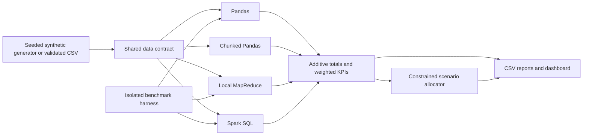

# Architecture and operations

## Components

`schema.py` defines required fields and validation. `analytics.py` supplies common
KPI logic so backends return the same contract. `mapreduce.py` sends CSV chunks to
worker processes and reduces partial totals in the parent process; at most twice
the worker count is queued. `spark.py` validates and aggregates on Spark executors
and collects only the small grouped result. Local MapReduce is a teaching
implementation rather than Hadoop, and Spark defaults to local execution.

`optimizer.py` consumes platform totals rather than raw personal records. The CLI
supports unattended generation, analysis, recommendations and benchmarks. The
dashboard focuses on moderate datasets with filters and downloadable reports.

## Memory and performance

Pandas loads the complete dataset. Chunked analysis and generation use bounded
chunks; MapReduce also bounds queued work. All grouped methods still require
memory proportional to distinct group keys. Spark uses JVM memory and can spill
work to disk. A faster backend on a small file is not necessarily faster at scale.

## Running and troubleshooting

- Use Python 3.11/3.12 and install the extras appropriate to your workflow.
- For Spark, verify `java -version` and `JAVA_HOME`; Java 17 is the reference setup.
- Launch the dashboard from the repository root using the README command.
- For CSV validation failures, inspect required columns and count constraints.
- For memory pressure, use `--backend chunked`, reduce `--chunk-size`, or use Spark.
- Benchmark logs are retained per backend/run. A failed backend produces a nonzero CLI exit.
- Large generated inputs and local artifacts are intentionally ignored by Git.

The container supplies Java and optional Spark dependencies and runs as an
unprivileged user. It is configured for local demonstration; hosting with private
data requires authentication and appropriate access controls.
